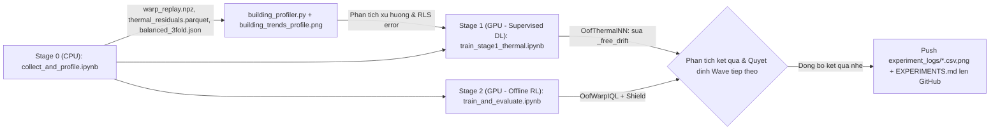

# ML_SBC: Workflow, Ly thuyet & Quy trinh Phat trien (NeurIPS 2026 Smart Buildings)

Tai lieu nay he thong hoa toan bo kien truc, co so ly thuyet, loi that bai da chan doan va quy trinh chay/push ket qua theo tung dot (Wave) de moi thanh vien trong nhom co the hieu, chay lai tren Kaggle, phan tich so lieu va dong bo len GitHub `https://github.com/tuandq2056/ML_SBC.git`.

---

## 1. Buc tranh Tong quan & Diem moc Bat buoc phai vuot qua

Bai toan yeu cau dieu khien he thong HVAC cho **30 kich ban = 6 toa nha x 5 che do thoi tiet** (`smart_buildings/training_scenarios`), toi uu ham thuong:

```text
Reward = 0.6 * Comfort - 0.2 * EnergyCost - 0.2 * CarbonEmissions
```

Hien tai chung ta co mot baseline vat ly rat manh la `EmptyDayConsistentPolicy` trong `physics_foundation.py` (dat ~`0.010` tren Kaggle LB). Toan bo thu nghiem cuc bo va danh gia OOF cua nhom chuan hoa theo **864 steps (72 gio = 3 ngay lien tiep)** de bao phu du ngay nghi lan ngay lam viec that va chu ky giu nuoc nong 72h:

| Toa nha | So kich ban | Base 864-step Mean | Ghi chu |
| :--- | :---: | :---: | :--- |
| `building_train_1` | 5 | `-6.6836` | Nang thu 2 khi chay du 72h (bi an khi chi chay 288 steps) |
| `building_train_2` | 5 | `-7.5227` | Nang nhat |
| `building_train_4` | 5 | `-3.3943` | Nhay cam cao voi AHU OOD trong kiem thu cu |
| `building_train_5` | 5 | `-2.4164` | Nhe nhat |
| `building_train_7` | 5 | `-3.8213` | Trung binh |
| `building_train_8` | 5 | `-6.5770` | Nang thu 3 |
| **Tong (30 kich ban)** | **30** | **`-5.0692 +/- 4.5757`** | **Moc so sanh chuan (Baseline 864 steps)** |

---

## 2. Cac Bai hoc That bai & Nguyen nhan Goc re (De nhom khong lap lai)

Truoc khi xau chuoi pipeline hien tai, nhom da ghi nhan 4 nguyen nhan lam mo hinh RL v1 (`TD3+BC` 5-Fold) sup do tu `-5.0692` xuong `-19.8996` (rieng Fold 3 `building_train_4` rot xuong `-81.3099`):

1. **Thu thap qua ngan (288 steps = 24h):** Ngay dau tien cua nhieu kich ban la ngay nghi/cuoi tuan (`99.1% AHU OFF`). Chay 288 steps lam `building_train_1` trong tuong nhu chi `-0.05`, nhung sang gio thu 24-72 khi co nguoi di lam thi nhay vot len `-6.6836`. Khac phuc: luon thu thap & danh gia **864 steps (72h)**.
2. **Chia 5-Fold `GroupKFold` tren chi 6 toa nha:** Moi fold chi co 1-2 toa nha validation voi do kho lech nhau qua lon (`-2.4` vs `-7.5`), gay lech phan phoi OOD nghiem trong giua tap train va tap val. Khac phuc: chuyen sang **Balanced 3-Fold Building-Scaffold** do `building_profiler.py` toi uu da tieu chi.
3. **Ham nen reward `symlog` (`log1p(|r| * 10)`):** Lam phang hinh phat vi pham nhiet do (tu muc phat gap ~50-100x xuong chi con ~5x), khien agent san sang danh doi nhiet do phong (mat comfort nang) chi de tiet kiem vai phan tram dien fan/chiller. Khac phuc: **chuan hoa tuyen tinh `r / std(r_train)`** ket hop `SmoothL1Loss(beta=2.0)`.
4. **Deterministic `TD3+BC` + `Q1` don le khong co la chan:** Policy tat dinh chu dong query `Q1(s', actor(s'))` vao vung hanh dong OOD (`Q` ao `+0.60`), sinh ra buoc nhay cuc doan tren toa nha la. Khac phuc: chuyen sang **Stochastic IQL-AWR + Epistemic Penalty + CAPS + Physics Safety Shield**.

---

## 3. So do Kien truc & Luong Chay Pipeline

Pipeline duoc chia lam 3 tang ro rang, tach biet thu thap CPU (khong ton quota GPU) va huan luyen GPU (2-5 phut/luot):



### Vai tro tung file trong repo

- `physics_foundation.py`: He thong dieu khien vat ly goc (`TransferPolicy -> ... -> EmptyDayConsistentPolicy` + bo uoc luong `bounded_rls`). Day la moc goc khong duoc lam yeu di.
- `building_profiler.py`: Tu dong phan tich xu huong 72h tung toa nha, tinh do nhay counterfactual action (`corr(delta_action, advantage)`), ve `building_trends_profile.png` va tim phan hoach **Balanced 3-Fold** can bang ca Base score, ty le AHU hoat dong, dien tich va nhiet do ngoai troi.
- `collect_and_profile.ipynb` *(Chay Kaggle CPU, Accelerator = None)*: Chay 30 kich ban x 864 steps de tao cache du lieu chuan dung chung cho moi thi nghiem sau, giup cac notebook GPU khong phai mat 60-80 phut chay lai simulator.
- `thermal_residual_net.py` & `train_stage1_thermal.ipynb` *(Chay Kaggle GPU)*: **Stage 1 — Danh vao Diem yeu #1 cua Base.**
- `warp_resip.py` & `train_and_evaluate.ipynb` *(Chay Kaggle GPU)*: **Stage 2 — Lop Offline RL an toan (`Stochastic IQL-AWR` + `Safety Shield`)**.

---

## 4. Khung Ly thuyet & Hyperparameter Cot loi

### Stage 1: Physics-Informed Neural Thermal Residual (`thermal_residual_net.py` + `train_stage1_thermal.ipynb`)

**Y tuong goc:** Ham `_features` cua `TransferPolicy` trong `physics_foundation.py` chi dung 5 bien tuyen tinh va **hoan toan bo qua gio nang (`hod_sin`, `hod_cos`) lan luong nguoi (`occ_norm`)**. Stage 1 giu nguyen bo giai AHU `_choose_ahu`, chi dung Deep Learning du bao phan sai so nhiet phi tuyen `rls_err_K = observed - rls_pred` voi tinh nhan qua chat che (khong dung `power` tuong lai).

- **Input (`THERMAL_FEAT_DIM = 11`):** `[hod_sin, hod_cos, occ_norm, oat_diff, slow_diff, group_diff, mode, model_error, residual/2, log(theta_gain), log1p(zone_area)/5]`.
- **Kien truc (`ThermalResidualResNet`):** 2 ResNet-MLP blocks (`hidden = 192`, LayerNorm + GELU), lop dau ra khoi tao `0` va chan cung bang `max_corr * tanh(.)` (`max_corr = 0.80` K).
- **Chong hoc trung RLS (Zero Double-Counting):** Trong `ThermalAugmentedPolicy._learn()`, sai so RLS chi duoc fit tren phan `delta - residual - nn_corr`, tuc RLS khong hoc de len phan ma mang neural da giai thich.
- **Hyperparameter huan luyen (`train_stage1_thermal.ipynb`):**
  - Split: Balanced 3-Fold (Zero-shot tren toa nha an).
  - Optimizer: `AdamW(lr=1e-3, weight_decay=1e-4)` + `CosineAnnealingLR(T_max=20)`, `BATCH_SIZE = 2048`, `EPOCHS = 20`.
  - Loss: `smooth_l1_loss(pred, y, beta=0.10) + 1e-3 * mean(pred^2)`.
  - Calibration tren simulator: quet `alpha_nn` trong `[0.3, 0.5, 0.8, 1.0]` de chon he so tron toi uu va luu vao `stage1_config.json`.

### Stage 2: Stochastic IQL-Warp + Physics-Uncertainty Gate + Shield (`warp_resip.py` + `train_and_evaluate.ipynb`)

**Y tuong goc:** Thay vi cho RL dieu khien truc tiep cac van/damper (de gay hong can bang nhiet-khoi), RL chi bieu dien mot phep **uon nhe (`RationalQuadraticWarp1D`)** quanh hanh dong vat ly `x_base` tren 4 chieu cap toa nha `[SAT, StaticPressure, Recirc, SupplyWater]`, dong thoi bi kiem soat boi 4 lop bao ve:

1. **Bounded Monotonic Spline + Identity Init:** `RationalQuadraticWarp1D(num_bins=8, bound=1.05, min_derivative=0.40, max_derivative=2.20)` khoi tao tai `W(x) = x` tuyet doi va co ham `inverse()` giai tich chinh xac de tinh `log_prob`.
2. **Physics-Uncertainty ResiP Gate:** Do lon cua phep uon bi nhan voi `gate = unc_scale * sigmoid(gate_head)`, voi `unc_scale = clamp((model_error - 0.04) / 0.16, 0.20, 1.0)`. Khi mo hinh vat ly doan dung (`model_error` nho), RL tu dong rut ve gan Base.
3. **Stochastic IQL-AWR + Epistemic Penalty + CAPS:**
   - **IQL Expectile Value (`DeepSetsValueNet`):** `IQL_TAU = 0.70`, `LR_V = 3e-4`. Hoc gia tri trang thai tu du lieu offline ma **khong can hoi hanh dong OOD**.
   - **Twin Critic (`DeepSetsAHUTwinCritic`):** `N_STEP = 6`, `GAMMA = 0.96` (`GAMMA_N = 0.96^6`), `LR_Q = 3e-4`, `POLYAK_TAU = 0.005`, dung `SmoothL1Loss(beta=2.0)` tren reward chuan hoa tuyen tinh `r / std`.
   - **Epistemic AWR Actor (`DeepSetsWarpResiPActor`):** `BETA_AWR = 3.0`, `EPI_PENALTY = 0.50` (`Q_cons = min(Q1, Q2) - 0.50 * |Q1 - Q2|`), `MAX_AWR_WEIGHT = 20.0`, `LR_A = 1.5e-4`, `TRAIN_ITERS = 3000`, `BATCH_SIZE = 256`, `EVAL_EVERY = 500`.
   - **CAPS Smoothness:** `CAPS_LAMBDA_T = 0.10` (chong giat theo thoi gian), `CAPS_LAMBDA_S = 0.05` voi `CAPS_SPATIAL_STD = 0.03` (on dinh truoc nhieu cam bien).
   - **Stratified Balanced Sampling:** moi minibatch lay theo ty le `40%` Active Explore / `25%` Active Anchor / `25%` Idle (chua chu ky giu boiler 72h) / `10%` Extreme Tail (`|r_n| >= 75th percentile`).
4. **Physics Safety Shield (`WarpResiPMixin._ahu_step_metrics`):**
   - Truoc khi phat lenh AHU da warp, he thong tinh `thermal_penalty` 1-buoc cho ca `base_choice` va `warped_choice`. Neu `pen_warp > pen_base + 1e-6`, la chan tu dong tra ve `base_choice` va ghi nhan `_shield_hits`.
   - Khi zone dang co nhu cau suoi (`any_reheat_10` hoac `temperature + free < low`), `water_target` khong duoc phep ha thap hon `base_water_target`.
   - Co san co `TARGET_WATER_ONLY = True/False` de thu nghiem rieng cho lo hong giu nuoc nong 72h cuoi tuan neu AHU warp bi chan nhieu.

---

## 5. Quy trinh Chay Kaggle & Push Ket qua sau tung Dot (Wave Protocol)

### Buoc 1: Chay & Tao Kaggle Dataset Cache (Wave 0)
1. Upload/Sync `collect_and_profile.ipynb` len Kaggle voi **Accelerator = None (CPU)**.
2. Nhan **Save & Run All (Commit)** (~40-80 phut).
3. Sau khi xong, vao muc **Output** cua phien Kaggle do, nhan **New Dataset** (dat ten vi du `ml-sbc-cache-864s`) hoac Attach Notebook Output truc tiep cho cac notebook GPU buoc sau.
4. Tai ve cac file phan tich nhe: `base_scores_*.json`, `balanced_3fold_*.json`, `building_trends_profile.png` va log bang `th_summary` + `df_prof`.

### Buoc 2: Chay Stage 1 & Stage 2 tren Kaggle GPU (Wave 1, Wave 2)
1. Tao notebook Kaggle GPU (P100 hoac T4), **Add Input** tro toi dataset `ml-sbc-cache-864s` (va dataset cuoc thi `neurips-2026-smart-buildings`).
2. Chay `train_stage1_thermal.ipynb` truoc (Save & Run All): lay `oof_stage1_thermal.csv`, `stage1_thermal_curves.png`, `stage1_config.json` va ghi lai `OOF Mean ThermalNN` + `mae_gain%`.
3. Chay `train_and_evaluate.ipynb` (Save & Run All): lay `oof_stage2_iql_warp.csv`, `stage2_iql_curves.png`, `oof_stage2_iql_warp.png` va ghi lai `OOF Mean Warp-IQL`, `shield_rate`, `Mean 4D Gate`.
4. **Luu y khi Submit Kaggle Leaderboard:**
   - Khi submit truc tiep tu `train_stage1_thermal.ipynb` hoac `train_and_evaluate.ipynb`, phien Kaggle Rerun (`IS_RERUN=True`) co the tu huan luyen nhanh tren GPU (~2 phut) neu ban van attach dataset `ml-sbc-cache-864s`, hoac nap thang cac file `*.pt` neu ban attach output da train vao Input.

### Buoc 3: Ma tran Quyet dinh Huong di tiep theo So lieu (Decision Matrix)

Sau moi dot chay, nhom dung bang quyet dinh sau de chot huong Wave ke tiep thay vi doan mo:

| Tin hieu quan sat duoc | Chan doan | Hanh dong Wave tiep theo |
| :--- | :--- | :--- |
| Stage 0: `rls_mae_K` cao ro ret theo gio nang / gio co nguoi | Stage 1 co du dia cai thien lon | Uu tien hoan thien Stage 1 (`train_stage1_thermal.ipynb`) |
| Stage 1: `OOF Diff > 0` va giam `nn_mae` o ca 3 fold | Stage 1 hoat dong that, khong leak | Submit Stage 1 len LB; chon `ThermalAugmentedPolicy` lam Base moi |
| Stage 1: giam `nn_mae` nhung `OOF Diff < 0` | `max_corr = 0.8` hoac `alpha_nn` qua manh lam lech damping | Giam `alpha_nn` (`0.15 - 0.30`) hoac chi ap dung NN khi `model_error > 0.15` |
| Stage 2: `shield_rate` cao (`> 25%`) tren AHU, `BestTrainedPilotDiff <= 0` | AHU warp van bi co han hoac `x_base[:3]` da gan toi uu cuc bo | Bat `TARGET_WATER_ONLY = True` de danh rieng vao lo hong boiler hold 72h |
| Stage 2: `OOF Diff > 0` on dinh va `shield_rate` thap | RL da tim ra chien luoc pre-cooling / boiler hold hieu qua | Ghep chong **Stage 1 + Stage 2** (`ThermalAugmentedPolicy` + `WarpResiPMixin`) |

### Buoc 4: Quy chuan Push Ket qua len GitHub sau moi dot phan tich

> **QUY TAC CUNG:** File `.gitignore` da chan toan bo `*.pt`, `*.pth`, `*.npz`, `*.parquet` va `results/`. **Khong bao gio** dung `git add -f` de day file checkpoint hay buffer hang tram MB len GitHub!

Chi day cac **bao cao & bieu do nhe** (< vài MB) vao thu muc `experiment_logs/wave_X_ten_dot/`:

```bash
# 1. Tao thu muc ket qua cho dot phan tich moi (vi du wave_1_thermal)
mkdir -p experiment_logs/wave_1_thermal

# 2. Copy file CSV, JSON, PNG nhe tu Kaggle Output vao thu muc nay
#    Vi du: oof_stage1_thermal.csv, stage1_thermal_curves.png, stage1_config.json, base_scores_*.json

# 3. Cap nhat bang tom tat ket qua & ket luan huong di moi vao EXPERIMENTS.md

# 4. Kiem tra cu phap cac module Python va xem trang thai git
python3 -m py_compile physics_foundation.py warp_resip.py building_profiler.py thermal_residual_net.py
git status

# 5. Commit & Push sach se len GitHub
git add EXPERIMENTS.md WORKFLOW.md experiment_logs/
git commit -m "Log Wave X: <tom tat ngan ket qua OOF / LB va huong tiep theo>"
git push origin main
```

De xem chi tiet nhat ky cac dot da chay va dien ket qua dot moi, mo file [`EXPERIMENTS.md`](EXPERIMENTS.md).
